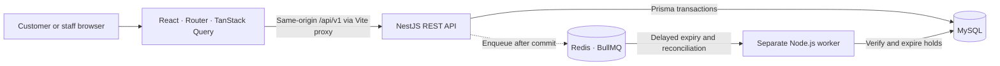
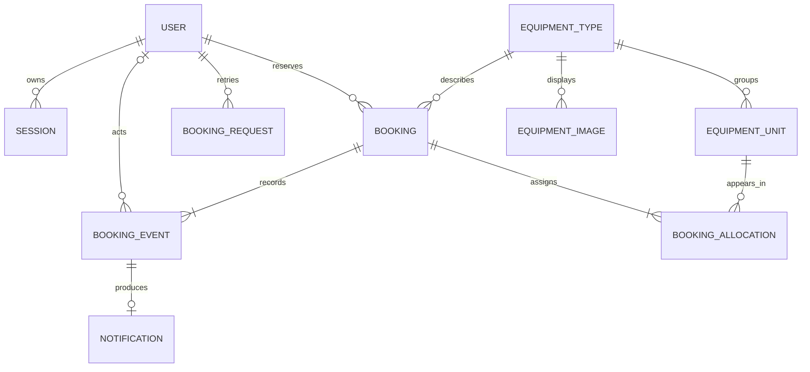
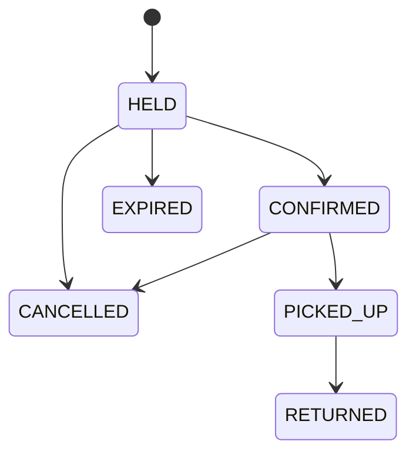

# Rental Operations Platform

A single-location equipment rental app. Customers browse equipment, check dates, hold units, and confirm reservations. Staff manage inventory, record pickups and returns, and see which rentals are overdue or blocking a handover.

The central guarantee is that concurrent requests cannot allocate the same physical unit for overlapping dates. The API enforces that rule using MySQL transactions and row locks. The worker records expiry and its in-app notification in the background.

## Run locally

Use Node.js 24 LTS (24.15 or later), npm, and Docker with Compose. The commands below use PowerShell. On macOS or Linux, use `npm` and copy `.env.example` with `cp` if you need a new `.env`.

```powershell
if (!(Test-Path .env)) { Copy-Item .env.example .env }
npm.cmd ci
docker compose up -d --wait
npm.cmd run db:generate
npm.cmd run db:migrate
```

Set `DEMO_STAFF_EMAIL` and `DEMO_STAFF_PASSWORD` in `.env` before seeding to create a staff account. Use an email such as `staff@example.test` and a development-only password of at least 12 characters. With both fields blank, the seed loads equipment and product photos. Rerunning the seed preserves existing accounts, passwords, and product galleries that already contain photos.

```powershell
npm.cmd run db:seed
npm.cmd run dev:api
```

In a second terminal at the project root, run `npm.cmd run dev:web`. Once the API compiles, run `npm.cmd run worker` in a third terminal and look for `expiry_worker_ready`.

| Page | Purpose |
| --- | --- |
| [Home](http://localhost:5173/) and [Catalog](http://localhost:5173/catalog) | See featured gear, browse all equipment, and check dates |
| [Sign in](http://localhost:5173/login) | Shared sign-in for customers and staff |
| [Register](http://localhost:5173/register) | Create a customer account |
| [My bookings](http://localhost:5173/bookings) and [Notifications](http://localhost:5173/notifications) | View bookings, confirmations, and expiries |
| [Staff bookings](http://localhost:5173/staff/bookings) and [Inventory](http://localhost:5173/staff/inventory) | Handle rentals and manage stock and product photos |
| [About](http://localhost:5173/about) and [Contact](http://localhost:5173/contact) | Read how rentals work and send questions to the [staff inbox](http://localhost:5173/staff/contact) |

In staff inventory, expand an equipment type and use **Product images** to upload or remove JPEG, PNG, or WebP files. Each gallery supports up to five images, at most 2 MB each. Its first photo appears in the catalog, and customers can select other photos on the detail page. The three seeded listings include AI-generated demonstration images.

Compose publishes MySQL on loopback port `13306` and Redis on loopback port `6379`. The API defaults to `3000` and the web app to `5173`. If you change the infrastructure ports, update their connection URLs in `.env`. If you change the web origin, update `WEB_ORIGIN` and restart the API. `docker compose down` stops the services and retains their named volumes.

## Architecture



The NestJS API has separate auth, catalog, inventory, booking, staff, and notification modules. Controllers validate input and delegate to services. React and the API share an origin locally through the Vite proxy. A hosted setup can use an HTTPS reverse proxy to serve the built web app and route `/api/v1` to NestJS.



An equipment type is a catalog listing. Its units are the physical items, each with a unique asset tag and service status. The booking allocation links a reservation to the exact units assigned during the hold. Booking history keeps those references after return, cancellation, or expiry.



Rental dates are calendar dates in `Asia/Colombo`. The start is inclusive and the end is exclusive. A July 10–12 rental uses July 10 and 11. Rentals can start up to 180 days ahead, last 1–30 days, and request 1–10 units of one type. Hold deadlines and event timestamps use UTC. Pickup is allowed during the rental dates. An open pickup becomes overdue when the exclusive end date begins in Colombo.

## Why the reservation stays correct

1. **Take the lock before checking.** The availability preview is a read. Hold creation locks the equipment type with a parameterized `SELECT … FOR UPDATE`, then reads MySQL's clock and checks inventory. Under `READ COMMITTED`, the availability query sees the previous lock holder's committed allocations. It chooses eligible units by ascending ID and saves all of them together or returns `409`. [MySQL consistent reads](https://dev.mysql.com/doc/refman/8.4/en/innodb-consistent-read.html)
2. **Save the retry outcome with the booking.** The idempotency record is unique per user, operation, and key. It stores a fingerprint and the original success or recorded conflict. A retry with the same input replays that outcome. A different payload conflicts. If matching keys race across two equipment types, the losing insert rolls back its allocations and event before reading the winning outcome.
3. **Keep booking validity in MySQL.** A hold stops blocking units at its deadline. Confirmation checks the deadline while holding the same equipment lock. The API attempts to enqueue only after commit. The worker applies expiry under the lock and reconciles up to 100 due holds per run, scheduled every 30 seconds by default. It can recover missed enqueues or downtime. A confirmation or expiry event and its notification commit together, with the event ID as the notification primary key. [BullMQ delayed jobs](https://docs.bullmq.io/guide/jobs/delayed) · [BullMQ Job Schedulers](https://docs.bullmq.io/guide/job-schedulers/)
4. **Check possession at the handover.** A prior pickup can still be open after its booked dates. Staff see the conflicting asset tag and prior booking ID. The API checks possession again under the equipment lock. The next booking stays confirmed until staff can hand it over.
5. **Keep the tradeoff visible.** Writes for one equipment type take turns, even for disjoint dates. Writes for different types can proceed independently. The lock keeps inventory changes and booking transitions under the same rule and limits contention to one type in this MVP.

## API and access control

The REST API is under `/api/v1`. Use [Swagger UI](http://localhost:5173/api/v1/docs) through Vite to try calls with the browser session. The [OpenAPI JSON](http://localhost:5173/api/v1/docs-json) lists DTOs, response codes, and cookie authentication.

| Method and path | Access and purpose |
| --- | --- |
| `GET /health` | Public API liveness |
| `POST /auth/register`, `POST /auth/login` | Create a customer account or sign in |
| `GET /auth/me`, `POST /auth/logout` | Read or revoke the current session |
| `GET /catalog/equipment-types`, `GET /catalog/availability` | Public catalog and date-range preview |
| `GET /catalog/images/:id` | Public product photo |
| `POST /bookings/holds`, `POST /bookings/:id/confirm` | Customer hold and confirmation. Both require `Idempotency-Key`. |
| `GET /bookings`, `GET /bookings/:id`, `POST /bookings/:id/cancel` | Read or cancel your own bookings |
| `GET /notifications` | Customer confirmation and expiry messages |
| `GET /staff/equipment-types`, `POST /staff/equipment-types` | List inventory and add an equipment type |
| `PATCH /staff/equipment-types/:typeId`, `DELETE /staff/equipment-types/:typeId` | Edit or remove a type |
| `POST /staff/equipment-types/:typeId/images`, `DELETE /staff/equipment-types/:typeId/images/:imageId` | Upload or remove a product photo as staff |
| `POST /staff/equipment-types/:typeId/units` | Add a physical unit with a unique asset tag |
| `PATCH /staff/equipment-types/:typeId/units/:unitId`, `DELETE /staff/equipment-types/:typeId/units/:unitId` | Edit the unit, change its service status, or remove it |
| `GET /staff/bookings`, `GET /staff/bookings/:id` | Staff dashboard, history, and booking events |
| `POST /staff/bookings/:id/pickup`, `POST /staff/bookings/:id/return` | Record all allocated units handed over or returned |
| `POST /contact`, `GET /staff/contact` | Submit a message or read the latest messages as staff |

For availability, pass `equipmentTypeId`, `startDate`, and `endDate` as query parameters. Hold creation uses those fields plus integer `quantity` in its JSON body. For retries, reuse the same key until the outcome is known. Use a fresh key for a new attempt after a definite conflict. The booking read endpoint shows the current status if an earlier result was replayed.

The API stores a hash of each random session token and sends the token in an HttpOnly, SameSite=Lax cookie. Production mode requires an HTTPS web origin and sets Secure. The API checks the configured `Origin` on writes, including login and logout. Passwords use salted scrypt. Registration and sign-in have per-IP rate limits. The browser and direct HTTP clients must use the configured origin for writes.

The standard error body has `statusCode` and `message`. Validation errors can return an array of messages. A customer requesting another customer's booking gets `404`. Staff access and same-origin violations return `403`, and stock or lifecycle conflicts return `409`. Use the `X-Request-Id` response header to find the associated structured request log. Enqueue and worker logs include booking and job IDs.

## Portfolio demo

Use two customer accounts in separate browser profiles and the staff account you seeded. For the last-unit demo, choose a type with one in-service unit and dates clear of existing bookings.

1. **Reserve.** Sign in as the first customer and check a free date range for Sony A7 IV. Place a hold, point out the countdown, and confirm. Show the booking and its confirmation message.
2. **Compete for the last unit.** Choose another date range and have both customers check it before either places a hold. Both previews can show one unit. Submit from both profiles and show the winning hold and the conflict. The integration test runs the same race on separate MySQL connections and verifies exactly one saved allocation.
3. **Expire a hold.** Set `HOLD_SECONDS=15` in `.env` and restart the API. Place a new hold and let it expire. Check that the dates become available again and that a notification appears after the worker processes the event. Restore `HOLD_SECONDS=900` and restart the API after the demo.
4. **Pick up and return.** Confirm a free booking starting today in Colombo and ending tomorrow. Sign in as staff, open the booking in **Confirmed pickups**, and record pickup. Record return from **Other open rentals**, then open the timeline to show both staff events.

For an interview, start with the last-unit race and trace the two requests through the equipment row lock, availability query, and allocation commit. Then explain what happens when Redis is down and when a client retries after a timeout.

## Tests and CI

After generating the Prisma client:

```powershell
npm.cmd run lint
npm.cmd run typecheck
npm.cmd run build
npm.cmd test
docker compose --env-file .env.example config --quiet
```

For integration and browser tests, use a separate MySQL schema ending in `_test`. With the sample Compose user, create it and run:

```powershell
$sql = "CREATE DATABASE IF NOT EXISTS rental_operations_test; GRANT ALL PRIVILEGES ON rental_operations_test.* TO 'rental'@'%';"
$sql | docker compose exec -T mysql sh -c 'MYSQL_PWD="$MYSQL_ROOT_PASSWORD" exec mysql -u root'

$env:TEST_DATABASE_URL = node --env-file=.env -p "const u = new URL(process.env.DATABASE_URL); u.pathname = '/rental_operations_test'; u.href"
$env:DATABASE_URL = $env:TEST_DATABASE_URL
npm.cmd run db:migrate
Remove-Item Env:DATABASE_URL
$env:TEST_REDIS_URL = node --env-file=.env -p "process.env.REDIS_URL"
npm.cmd run test:integration

npx.cmd playwright install chromium
npm.cmd run test:browser
Remove-Item Env:TEST_DATABASE_URL
Remove-Item Env:TEST_REDIS_URL
```

- **Unit and foundation tests** check booking transitions, Colombo date rollover, startup validation, and the health API.
- **MySQL integration tests** check concurrent holds on separate connections, atomic allocations, date overlap, concurrent retries, ownership, and overdue handover conflicts. **Redis integration tests** exercise delayed expiry, a late job after confirmation, repeat delivery, and recovery after missed enqueue and restart.
- **Browser smoke tests** run against the built React app and a separate API on ports `15173` and `13000`. They cover customer registration through confirmation and staff pickup through return. The tests create and clean up their own equipment and accounts.
- **GitHub Actions** provisions MySQL and Redis services, migrates the test schema, and runs the checks above on pushes and pull requests. Browser traces and screenshots are uploaded on failure. [Workflow file](.github/workflows/ci.yml)
